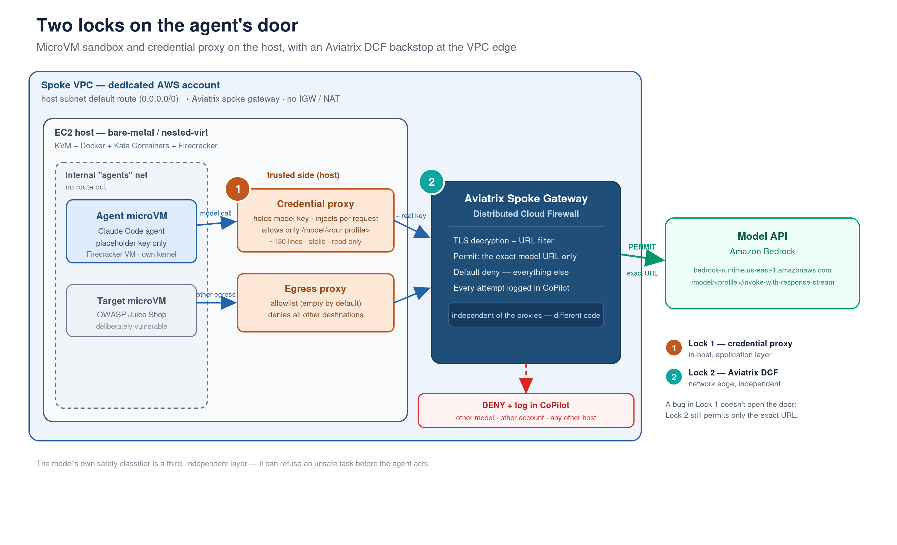

# agent-sandbox-aviatrix

Reference implementation of Anthropic's [agent containment / sandboxing guidance]() on AWS, with a second, independent egress control: an Aviatrix spoke gateway running Distributed Cloud Firewall (DCF) at the VPC edge.

Each agent runs in its own Firecracker microVM (Kata Containers) on an internal Docker network with no route out. A credential proxy holds the model-API key and forwards only model calls; an egress proxy denies everything else. The host's entire egress is also forced through a spoke gateway that permits only the model API and logs every denied attempt. With URL filtering on, the gateway decrypts TLS and permits only the exact model endpoint path.



## What you get

Two independent controls on the same host:

| Lock | Where | What it enforces |
|---|---|---|
| In-host proxies | On the sandbox host, next to each agent | Credential injection; only model calls leave an agent; empty egress allowlist |
| Aviatrix DCF | Spoke gateway at the VPC edge, logged in CoPilot | Default-deny for the whole host; only the model API (optionally the exact URL path) is permitted |

A bug or bypass in a proxy is still contained by the gateway, and the gateway's logs live outside the host.

## Layout

```
terraform/base/       VPC, private host subnet, SSM endpoints, IAM, EC2 host.
terraform/aviatrix/   Spoke gateway + DCF policy (SNI or URL filtering). Apply after base.
host/                 bootstrap.sh: Docker + containerd (devmapper) + Kata + Firecracker, hardened
proxies/              credproxy (holds the key, path-restricted) and egressproxy (allowlist, empty by default)
agent/                Sample agent image (Claude Code) and task files, incl. the supervised escape tests
scripts/              Build images, start proxies/target, launch an agent run, validation and DCF demo scripts
docs/                 deploy.md, validation.md, dcf-policy.md, architecture.md
```

## Quick start

```bash
# 1. Network + host
cd terraform/base
cp terraform.tfvars.example terraform.tfvars   # set profile, instance type
terraform init && terraform apply

# 2. Spoke gateway + DCF, setup-phase policy
cd ../aviatrix
cp terraform.tfvars.example terraform.tfvars   # controller, account name, model API host
terraform init && terraform apply

# 3. On the host (SSM), build the runtime and images
$(terraform -chdir=../base output -raw ssm_connect)
sudo KATA_VERSION=3.x.y KATA_SHA256=<digest> host/bootstrap.sh
scripts/build-images.sh
scripts/start-egress-proxy.sh && scripts/start-target.sh

# 4. Close the setup-phase holes, then validate and run
terraform -chdir=terraform/aviatrix apply -var setup_phase=false
scripts/verify-isolation.sh probe        # see docs/validation.md
scripts/launch.sh run-01 agent/tasks/smoke.md 30 1h
```

Full steps, including copying files to a host that has no inbound path, are in [docs/deploy.md](docs/deploy.md).

## Requirements

- An AWS account you can dedicate to this. The host holds a model-API credential and runs adversarial tests; don't share it with other workloads.
- An EC2 type that exposes KVM: a nested-virtualisation family (`c8i`, `m8i`, `r8i`) or any `*.metal`.
- A model-API credential scoped only to agent runs (Bedrock API key, Anthropic API key, or Vertex). Pick one provider.
- An Aviatrix Controller/CoPilot 9.0+ with DCF enabled and an access account for the AWS account above. The Terraform uses provider resources introduced in 9.0 (`aviatrix_config_feature`, `aviatrix_dcf_mitm_ca`); pin the provider to your controller release.
- Terraform >= 1.6, AWS CLI with Session Manager plugin.

## Documents

- [docs/architecture.md](docs/architecture.md): components, trust boundaries, why two locks
- [docs/deploy.md](docs/deploy.md): end-to-end deployment
- [docs/dcf-policy.md](docs/dcf-policy.md): DCF rules, SNI vs URL filtering, the account-binding caveat
- [docs/validation.md](docs/validation.md): isolation checks, supervised escape test, and the "proxy forwards, gateway denies" demo

## Notes

- The model-API host is never added to the agents' egress allowlist. Agents reach the model only through the credential proxy.
- The credential never enters an agent container. It is written into the credential proxy's tmpfs per launch.
- Treat the host as disposable. Rebuild rather than reuse after a failed escape test.

## License

Apache License 2.0. See [LICENSE](LICENSE).
