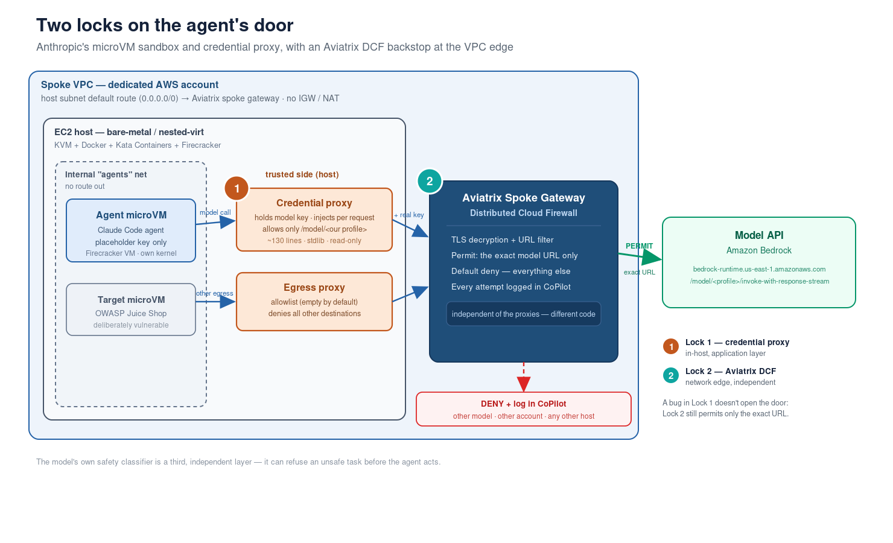

# Architecture

## Components

**Spoke VPC.** A dedicated VPC in a dedicated AWS account. One private subnet for the host. The host subnet never has a route to the internet gateway. In `aviatrix` mode its default route is programmed by the Aviatrix controller to the spoke gateway; in `nat` mode it points at a NAT gateway.

**Host.** One EC2 instance with KVM (nested-virt family or metal), Ubuntu 24.04, no public IP, no inbound security-group rules, SSM-only management through interface endpoints, IMDSv2 with hop limit 1, swap off. Docker uses the containerd devmapper snapshotter on a dedicated EBS volume; Kata Containers runs Firecracker through the jailer with the article's pinned settings (`host/kata-harden.py`). Guest kernel and image are made immutable.

**Internal `agents` network.** A Docker `--internal` bridge. Nothing on it has a default route. Each agent gets a fresh microVM attached through a companion container that holds the network namespace (a Kata requirement). The vulnerable target runs in its own microVM on the same bridge with a static IP.

**Credential proxy** (`proxies/credproxy`). Trusted side, plain `runc`, one per launch. Accepts requests only from the launched agent's IP, only on an allowed path prefix, strips any auth headers the agent sent, injects the real credential from a tmpfs file, and forwards to a single configured provider host over verified TLS. Logs method/path/status, never headers or bodies.

**Egress proxy** (`proxies/egressproxy`). Trusted side, long-running. Deny-by-default `host:port` allowlist that ships empty. CONNECT tunnels for HTTPS, header-based for HTTP. Logs ALLOW/DENY per connection.

**Aviatrix spoke gateway + DCF** (`aviatrix` mode). The host's `0.0.0.0/0`. A SmartGroup selects the host subnet; a WebGroup names the model API; the policy permits only that, permits package sources only during setup, and denies everything else with logging. With `url_filtering = true` the permit WebGroup is URL-type and the rule decrypts TLS, so only the listed endpoint paths pass and any other path on the model domain is denied.

**Model API.** Bedrock, the Anthropic API, or Vertex. The credential proxy is the only thing that talks to it.

## Trust boundaries

| Boundary | Enforced by | Independent of |
|---|---|---|
| Agent cannot see host or other VMs | Firecracker microVM, jailer, seccomp, separate kernel | network, proxies |
| Agent has no route out | `--internal` bridge, no default route, metadata hop limit | DCF |
| Agent never holds the credential | credential proxy injects per request; placeholder in agent env | DCF |
| Only model calls leave via the credential | credential proxy path check | DCF |
| Only the model API leaves the VPC | DCF default-deny at the gateway | proxies |
| Only the exact model endpoint path leaves the VPC | DCF URL filtering with TLS decryption | proxies |

## Why two locks

The proxies are the one component an attacker-controlled agent talks to directly, and they are application code on the trusted side of the boundary. A parsing bug (path-prefix bypass, header smuggling, a CONNECT target that matches the allowlist string but connects elsewhere) hands the attacker the credential or open egress without any VM escape. The proxies here are small and locked down, which lowers the odds, but the design assumes they will eventually have a flaw.

DCF enforces the same scope again at the network edge with different code in a different trust domain. If a proxy is bypassed, the gateway still only lets the one permitted destination out, and the attempt is logged centrally. `scripts/dcf-url-demo.sh` demonstrates this by leaving a deliberate scoping gap in the credential proxy and showing the gateway deny what the proxy forwarded.

## A third layer

Current Claude models include a server-side safety classifier. In testing, Sonnet 5.5 refused the offensive escape-test task before the agent made any tool call, regardless of the harness permission mode. That is an additional independent control, not a replacement for the two above: it can be absent on other models, and it sometimes flags benign security work. Design for the case where the model does not refuse.
